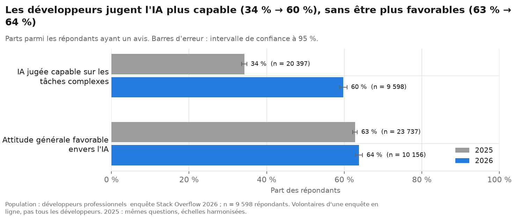
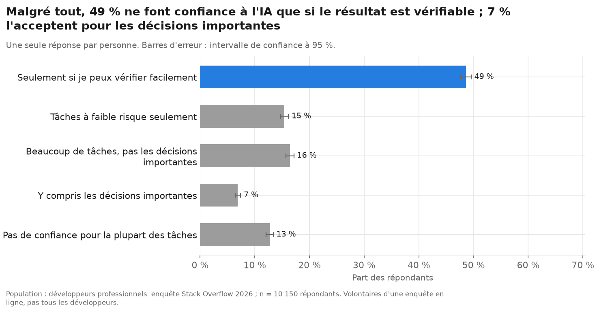
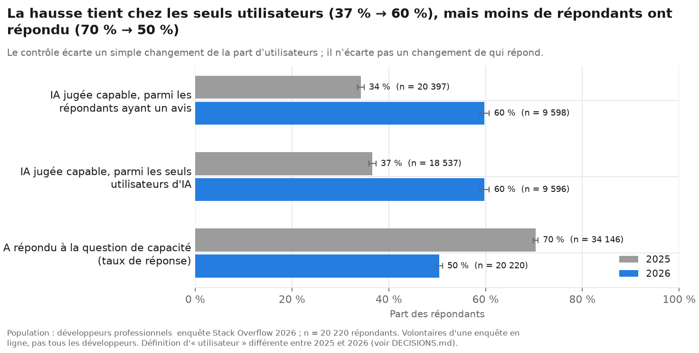

# L'IA est jugée plus capable, mais elle reste vérifiée : financer la vérification autant que les licences

**En une phrase.** Parmi les développeurs professionnels de l'enquête Stack Overflow, la capacité perçue de l'IA sur les tâches complexes est passée de 34 % à 60 % en un an, alors que l'attitude générale n'a pas bougé et que la confiance reste conditionnée à la vérification. <!-- P02 P03 -->

## Ce que nous savons

- 60 % des répondants jugent l'IA « bonne » ou « très bonne » sur les tâches complexes en 2026, contre 34 % en 2025. <!-- P02 P03 -->
- La hausse existe aussi chez les seuls utilisateurs d'IA : 37 % puis 60 %. <!-- P08 P09 -->
- L'attitude générale est stable : 63 % puis 64 % de favorables. <!-- P04 P05 -->
- 49 % ne font confiance à l'IA que si le résultat est facile à vérifier ; 7 % l'acceptent pour les décisions importantes. <!-- P06 P07 -->
- Les erreurs les plus coûteuses citées sont le code plausible mais faux (72 %) et le code difficile à relire (58 %). <!-- P12 P13 -->
- Le sujet n'est plus de savoir si les développeurs utilisent l'IA (87 % le font), mais s'ils peuvent s'y fier. <!-- P01 -->

## Ce que nous ne savons pas

- Si l'IA est réellement plus capable : l'enquête recueille des déclarations, ni la qualité du code ni la productivité.
- Si les répondants de 2026 ressemblent à ceux de 2025 : le taux de réponse à cette question est passé de 70 % à 50 %. <!-- P10 P11 -->
- Si ces parts valent pour tous les développeurs : ce sont des volontaires, sans pondération.
- Pourquoi les opinions ont changé : aucun lien de cause n'est établi.

## Ce que nous recommandons

Équiper les développeurs, et budgéter la vérification (revue de code, tests automatiques, traçabilité) au même titre que les licences. Pour vérifier cette piste avant de généraliser : suivre deux équipes pilotes pendant un trimestre et comparer la part de code généré rejeté en revue et le temps de relecture, avec et sans règles de vérification. Si l'écart est faible, la recommandation tombe.

## Figures

## Source et méthode

Stack Overflow Developer Survey 2026 (30 903 réponses valides) et 2025, licence ODbL. Population : développeurs professionnels (20 220 en 2026). Parts avec intervalle de Wilson à 95 %, non dessinées sous 30 répondants. Seules deux questions sont comparées entre 2025 et 2026. Chiffres recalculés par `scripts/build_brief.py` (`docs/preuves.csv`).

**Niveau de confiance : moyen.** La hausse existe aussi chez les seuls utilisateurs, mais la baisse du taux de réponse empêche de la tenir pour acquise.
